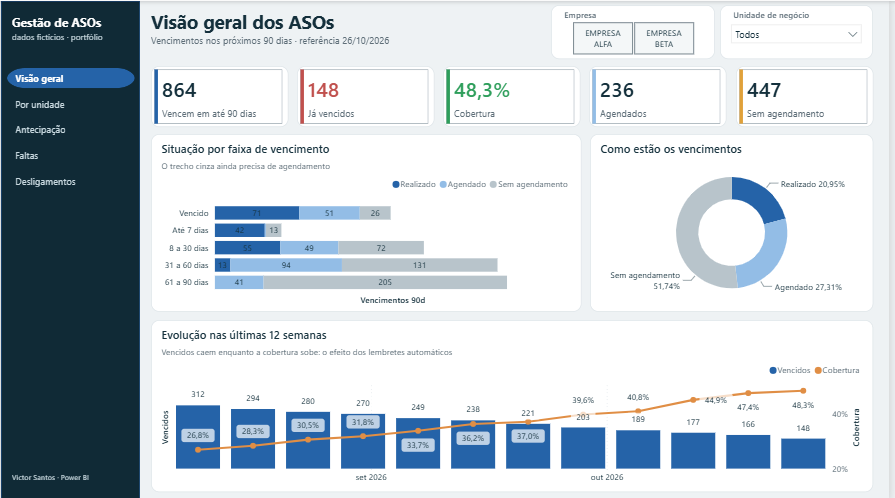
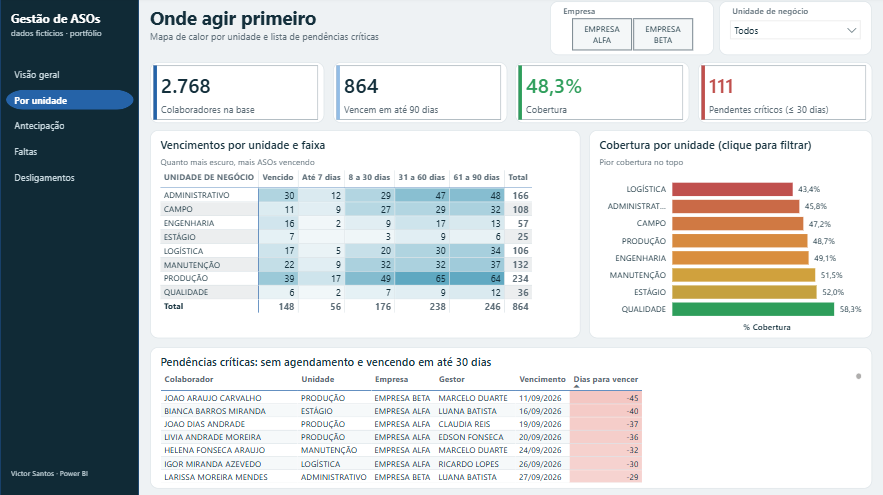
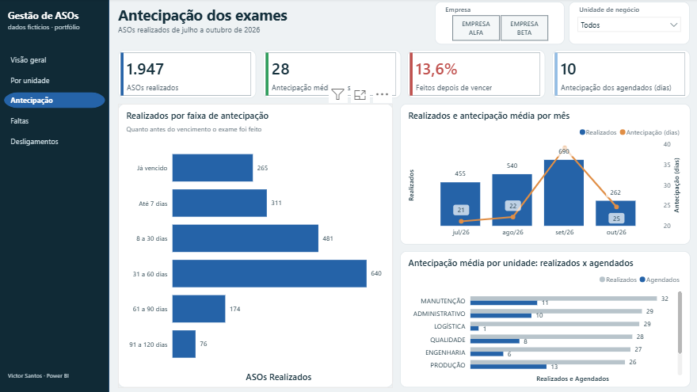
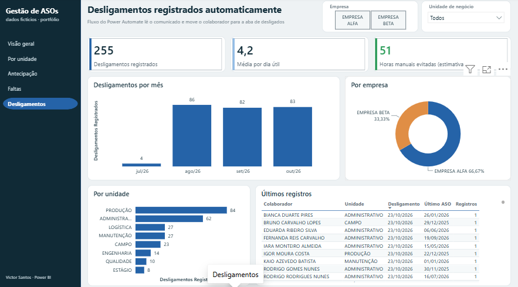
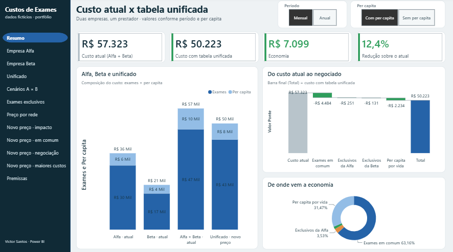
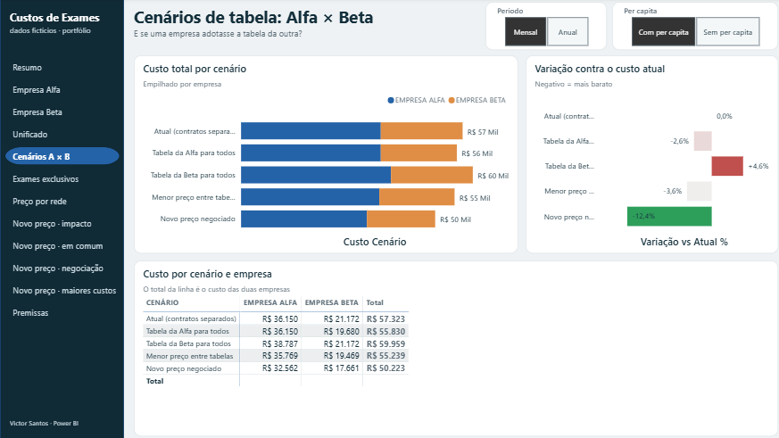
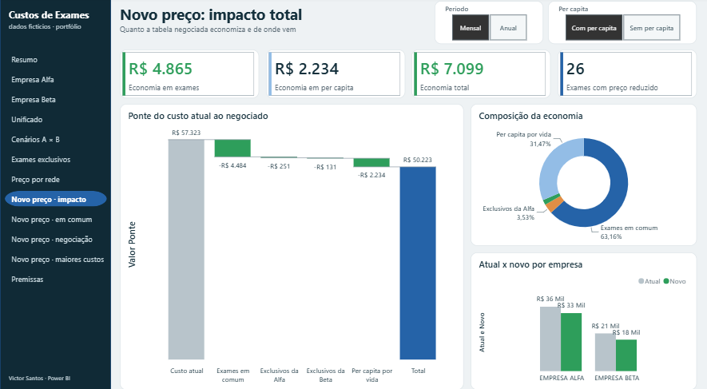
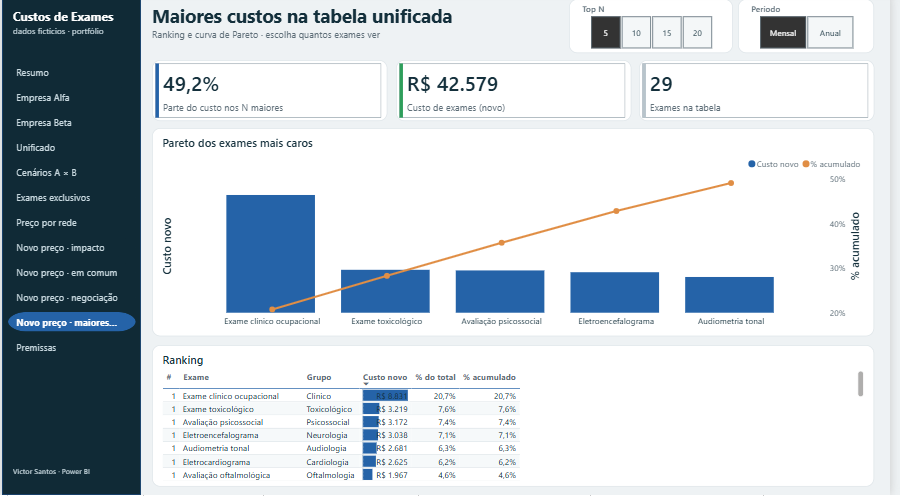

# Portfólio SSO: controle de ASOs e custos de exames em Power BI

> Automações do mesmo projeto (PowerShell + Power Automate): [automacoes-sso](https://github.com/vitoliro/automacoes-sso)

Dois relatórios Power BI completos, em formato PBIP, construídos sobre **dados 100% fictícios** gerados por script. Eles reproduzem a estrutura de soluções reais de Saúde Ocupacional (SSO), sem nenhum dado de empresa, pessoa ou contrato real.

| Relatório | Páginas | O que responde |
|---|---|---|
| **Controle_ASOs_DEMO** | Visão geral · Por unidade · Antecipação · Faltas · Desligamentos | Quantos ASOs vencem em 90 dias, quanto já está coberto, onde agir primeiro, como está a antecipação, quem falta aos exames e quantos desligamentos o fluxo automático registrou. Base de 2.900 colaboradores. |
| **Custos_Exames_DEMO** | Resumo · Empresa Alfa · Empresa Beta · Unificado · Cenários A × B · Exames exclusivos · Preço por rede · Novo preço (impacto, em comum, negociação, maiores custos) · Premissas | Quanto custa hoje cada empresa, quanto custaria a tabela unificada, com e sem per capita, em visão mensal e anual, e de onde vem cada real de economia. |

## Telas

### Controle de ASOs

| Visão geral | Onde agir primeiro |
|---|---|
|  |  |
| **Antecipação** | **Desligamentos automáticos** |
|  |  |

### Custos de exames

| Resumo: Alfa, Beta e unificado | Cenários A × B |
|---|---|
|  |  |
| **Novo preço: impacto** | **Maiores custos (Pareto)** |
|  |  |

As demais páginas estão na pasta [`imagens`](imagens).

## Destaques técnicos

- **Power Query:** regras de negócio na carga (base de cálculo, faixas de vencimento, situação do agendamento), junções entre tabelas e colunas derivadas.
- **Modelo:** estrela, com dimensões de empresa, unidade, faixa e exame. Tabelas de parâmetro desconectadas (período, per capita, cenário, comparativo, ponte, Top N) são lidas com `SELECTEDVALUE`.
- **DAX:** 73 medidas organizadas em pastas, incluindo `SUMX` exame a exame, `CALCULATE` por empresa, `RANKX` com Top N dinâmico, curva de Pareto, cascata de economia e média por dia útil com `CALENDAR`.
- **Relatório:**
  - navegação lateral entre páginas, cartões com barra de destaque e filtros sincronizados entre páginas;
  - filtros de página, mapa de calor por unidade e faixa, barras de dados e cores condicionais;
  - gráficos de colunas e linha combinados, além de rosca e cascata.

## Como abrir

1. Extraia a pasta `Portfolio-SSO` direto em `C:\`, de modo que as planilhas fiquem em `C:\Portfolio-SSO\dados\`.
2. Abra `Controle_ASOs_DEMO.pbip` ou `Custos_Exames_DEMO.pbip` no Power BI Desktop. O projeto abre **sem dados**, porque o cache não é versionado.
3. Clique em **Página Inicial › Atualizar**.
4. Se as planilhas estiverem em outra pasta, use **Transformar dados › Editar parâmetros** e ajuste `PastaDados`. O caminho termina com `\`.

Requer Power BI Desktop de março de 2026 em diante, quando o formato PBIR passou a ser o padrão. Em versões anteriores, ative antes em **Arquivo › Opções e configurações › Opções › Recursos de visualização**: "Power BI Project (.pbip) save option" e "Store reports using enhanced metadata format (PBIR)".

## Números esperados após atualizar

Sem filtros, com período mensal e com per capita.

| Onde | Indicador | Valor |
|---|---|---|
| ASOs · Visão geral | Vencem em até 90 dias / vencidos / cobertura | 864 / 148 / 48,3% |
| ASOs · Por unidade | Pendentes críticos (≤ 30 dias, sem agendamento) | 111 |
| ASOs · Antecipação | Realizados / antecipação média / feitos já vencidos | 1.947 / 28 dias / 13,6% |
| ASOs · Faltas | Faltas / pessoas / reincidentes | 353 / 300 / 46 |
| ASOs · Desligamentos | Registrados / horas manuais evitadas (estimativa) | 255 / 51 |
| Custos · Resumo | Atual → unificado | R$ 57.323 → R$ 50.223 (−12,4%) |
| Custos · Empresa Alfa | Atual → novo | R$ 36.150 → R$ 32.562 (−9,9%) |
| Custos · Empresa Beta | Atual → novo | R$ 21.172 → R$ 17.661 (−16,6%) |
| Custos · Exclusivos / em comum | Exames | 10 / 19 |
| Custos · Maiores custos | Top 10 concentra | 72,2% do custo de exames |

## Estrutura

```
Portfolio-SSO/
├── dados/                         planilhas fictícias (fonte do Power Query)
├── Controle_ASOs_DEMO.pbip        + .SemanticModel (TMDL) e .Report (PBIR)
├── Custos_Exames_DEMO.pbip        + .SemanticModel (TMDL) e .Report (PBIR)
└── scripts/
    ├── gerar_dados.py             gera as planilhas fictícias (semente fixa)
    ├── gerar_pbip.py              auxiliares de TMDL e Power Query
    ├── gerar_pbip_v2.py           gera os dois relatórios
    └── checar_pbip.py             confere campos, DAX, Power Query e relacionamentos
```

## Regras de negócio

- **Base de cálculo (ASOs):** status Ativo, Férias ou Licença Remunerada. Afastados e exceções de diretoria ficam fora.
- **Agendado:** data de agendamento futura. **Realizado a atualizar:** a data já passou, mas o ASO novo ainda não entrou na base.
- **Antecipação:** dias entre o exame e o vencimento anterior. O valor é negativo quando o exame foi feito depois do vencimento.
- **Custo (exames):** volume mensal × preço, exame a exame. O per capita é cobrado por vida ativa e pode ser excluído pelo filtro "Per capita".
- **Visão anual:** visão mensal × 12, sem sazonalidade.
- **Data de referência:** 26/10/2026, no parâmetro `DataReferencia`, para que os números não mudem com o dia em que o arquivo é aberto.

## Sobre os dados

Nomes, CPFs (todos começam com `000`), CNPJs, e-mails, unidades, preços e volumes foram gerados por `scripts/gerar_dados.py`. Nenhuma linha vem de base real.
